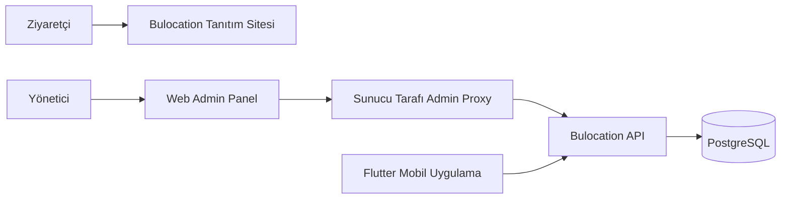

<div align="center">

# 🌐 Bulocation — Web & Admin Panel

### QR tabanlı iç mekân navigasyonunun tanıtım sitesi ve tesis yönetim arayüzü

[](https://react.dev/)
[](https://www.typescriptlang.org/)
[](https://vite.dev/)
[](https://tailwindcss.com/)

**[Web Sitesi](https://bulocation.com)** · **[Backend API](https://github.com/mikdatkerem/bulocation-api)** · **[Mobil Uygulama](https://github.com/mikdatkerem/bulocation-mobile-app)**

</div>

---

## 🚀 Proje Hakkında

**Bulocation**, hastane, alışveriş merkezi, otopark ve benzeri kompleks kapalı alanlarda yön bulmayı kolaylaştırmayı hedefleyen bir iç mekân navigasyon platformudur.

Bu depo iki farklı web deneyimini bir arada sunar:

- **Tanıtım sitesi:** Bulocation'ın kullanım alanlarını, özelliklerini ve çalışma mantığını ziyaretçilere açıklar.
- **Yönetim paneli:** Organizasyon, tesis, bina, kat, harita, kamera ve kullanıcı kayıtlarını yönetmek için operasyonel arayüz sağlar.

Web arayüzü, harita ve tesis verilerini ayrı geliştirilen **Bulocation API** üzerinden kullanır; veritabanına doğrudan bağlanmaz.

## ✨ Özellikler

### 🌍 Tanıtım Sitesi

- Bulocation ürününün ve kullanım senaryolarının tanıtımı
- Otopark, hastane ve alışveriş merkezi gibi farklı kullanım alanları
- QR kod, kat haritaları, rota ve park doluluğu özelliklerinin anlatımı
- Türkçe/İngilizce içerik desteği
- Mobil ve masaüstü ekranlara uyumlu arayüz
- Animasyonlar ve etkileşimli tanıtım bölümleri

### 🛠️ Yönetim Paneli

- Organizasyon, yerleşke, bina ve kat yönetimi
- Tesis kullanıcılarının ve yetkilerinin yönetilmesi
- Kat planları ve yayımlanacak haritaların yönetimi
- Kamera kayıtlarının ve ilgili tesis bilgilerinin yönetimi
- Mobil uygulamanın kullanacağı yayınlanmış harita verilerinin hazırlanması

> **Not:** Ürünün genel tanıtım sayfası ile yönetim paneli farklı kullanıcı gruplarına yöneliktir. Yönetim işlemleri API tarafındaki kimlik ve yetki kontrollerine bağlıdır.

## 🖼️ Ekran Görüntüleri

Henüz ekran görüntüleri eklenmedi. Görseller hazır olduğunda `screenshots/` klasörüne koyup aşağıdaki örnek satırların yorum işaretlerini kaldırabilirsiniz.

<!--
### Ana Sayfa


### Özellikler


### Yönetim Paneli


### Mobil Görünüm

-->

## 🧰 Teknolojiler

| Teknoloji | Kullanım amacı |
| --- | --- |
| **React 19** | Bileşen tabanlı kullanıcı arayüzü |
| **TypeScript** | Tip güvenli geliştirme |
| **Vite 7** | Geliştirme sunucusu ve üretim derlemesi |
| **Tailwind CSS 4** | Tasarım ve responsive stiller |
| **Framer Motion** | Arayüz geçişleri ve animasyonlar |
| **Lucide React** | İkon sistemi |
| **QR Code** | QR görselleri üretme akışları |

## 🏗️ Sistem Mimarisi



Yerel geliştirmede web uygulaması **`http://localhost:5173`**, API ise **`http://localhost:5011`** üzerinde çalışır. Admin istekleri web sunucusunun `/admin-api` proxy yolu üzerinden API'ye iletilir.

## ⚙️ Kurulum

**1. Depoyu klonlayın**

```bash
git clone https://github.com/mikdatkerem/bulocation-landing-page.git
cd bulocation-landing-page
```

**2. Bağımlılıkları kurun**

```bash
npm install
```

**3. Ortam ayarlarını oluşturun**

`.env.example` dosyasından `.env.local` oluşturun:

```env
VITE_ADMIN_API_TARGET=http://localhost:5011
VITE_ADMIN_API_BASE_URL=/admin-api
VITE_ADMIN_MAP_ASSET_BASE_URL=/admin-map-assets
VITE_MAPSITE_BASE_URL=https://bulocation.com
ADMIN_APP_SECRET=
```

> `ADMIN_APP_SECRET` **sunucu tarafında** tutulmalıdır. Bu değeri `VITE_` ile başlayan ve tarayıcı paketine giren bir değişkene taşımayın. Yerel API erişimi için gerekli anahtarı yalnızca güvenli yerel yapılandırmada tanımlayın.

**4. Geliştirme sunucusunu başlatın**

```bash
npm run dev
```

Uygulamayı `http://localhost:5173` adresinden açın. Yönetim paneli için Bulocation API'nin de çalışıyor olması gerekir.

### Üretim benzeri yerel çalıştırma

```bash
npm run build
npm run serve:prod
```

`serve:prod`, statik çıktıyı sunarken `/admin-api`, `/admin-map-assets` ve `/storage/maps` yollarını API'ye yönlendirir. `npm run preview:prod` ise yalnızca statik önizleme içindir; yönetim paneli proxy davranışının yerini tutmaz.

### Kod Kalitesi

```bash
npm run build
npm run lint
```

## 📁 Proje Yapısı

```text
bulocation-landing-page/
├── src/
│   ├── components/       # Tanıtım sitesi bileşenleri
│   ├── features/admin/   # Yönetim paneli
│   ├── hooks/            # Ortak hook'lar / dil yönetimi
│   └── App.tsx           # Site ve admin yönlendirme giriş noktası
├── scripts/
│   └── serve-prod.mjs    # Üretim benzeri statik sunucu / API proxy
├── public/
├── .env.example
├── vite.config.ts
└── package.json
```

## 🔐 Güvenlik ve Dağıtım

- API istekleri için **aynı-origin proxy** yaklaşımı kullanılır.
- Yönetim paneli uygulama anahtarı, tarayıcıya açık `VITE_*` değişkenlerinde tutulmaz.
- Yetkilendirme yalnızca menü gizlemeye dayanmaz; backend kontrolleri esastır.
- Üretimde `https://bulocation.com` ve `https://api.bulocation.com` adresleri için ters proxy / yönlendirme yapılandırması dağıtım ortamında ayrıca yapılmalıdır.
- Bu repo tek başına backend veya harita servisinin yerine geçmez.

## 🔗 Bulocation Ekosistemi

| Depo | Sorumluluk |
| --- | --- |
| [bulocation-api](https://github.com/mikdatkerem/bulocation-api) | Backend, veri yönetimi, yönlendirme ve SignalR |
| **bulocation-landing-page** | Tanıtım sitesi ve yönetim paneli |
| [bulocation-mobile-app](https://github.com/mikdatkerem/bulocation-mobile-app) | Flutter mobil navigasyon uygulaması |

## 📄 Lisans

Bu depoda açık bir lisansın varlığı doğrulanmadı. Yeniden kullanım/dağıtım hakları lisans tanımlanana kadar varsayılmamalıdır.

---

<div align="center">

**Bulocation — İç mekânlarda yolunuzu bulun.**

Geliştirici: [Mikdat Kerem Kalkan](https://github.com/mikdatkerem)

</div>
